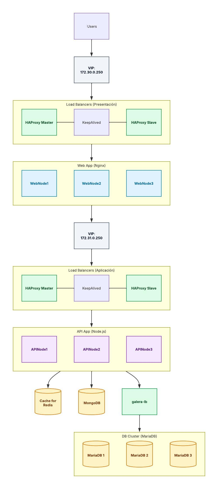
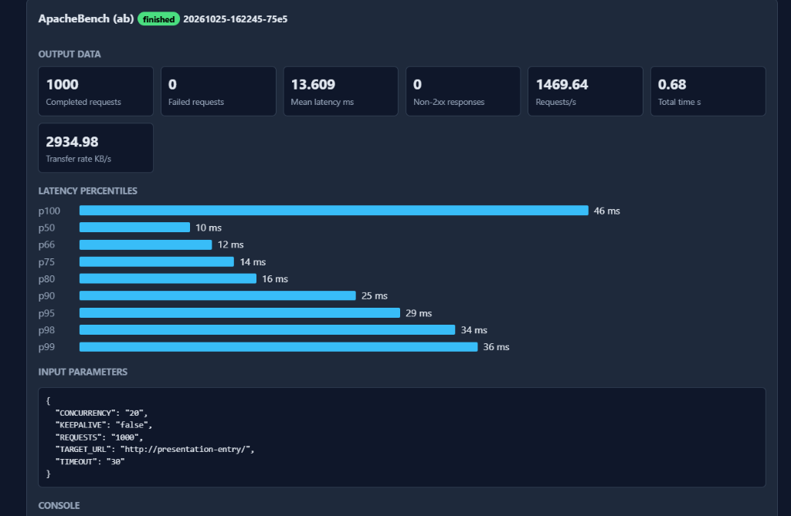
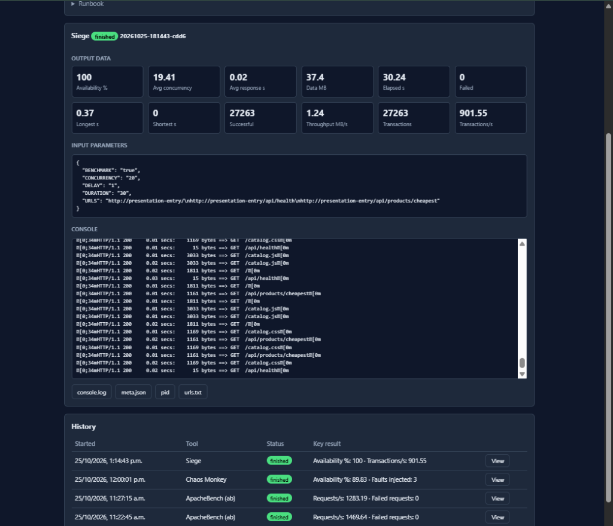
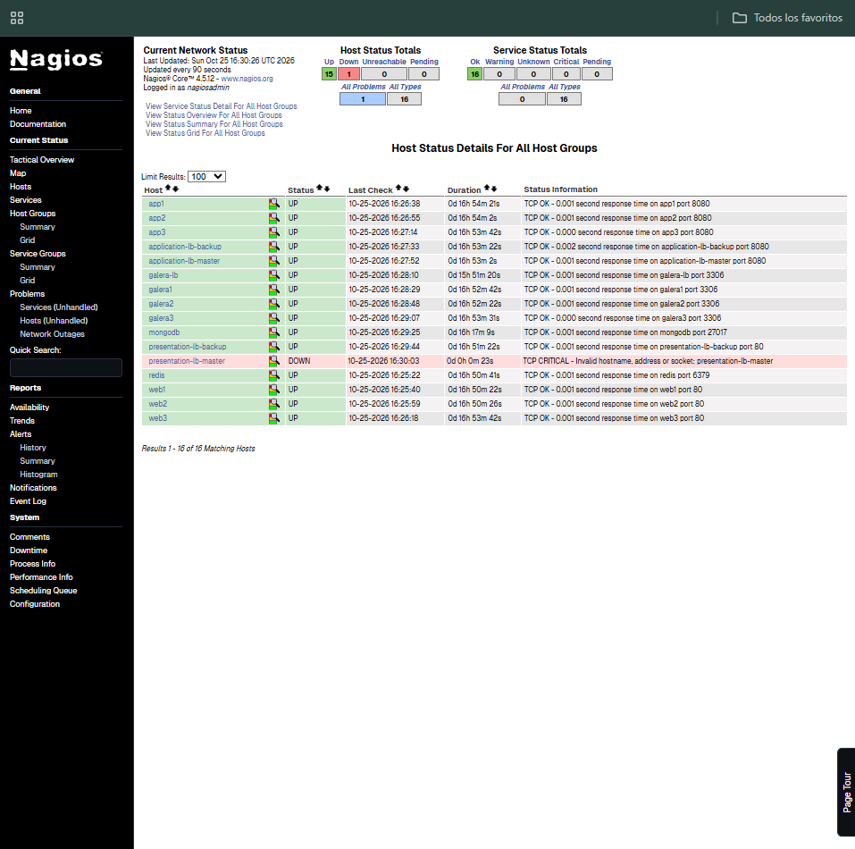
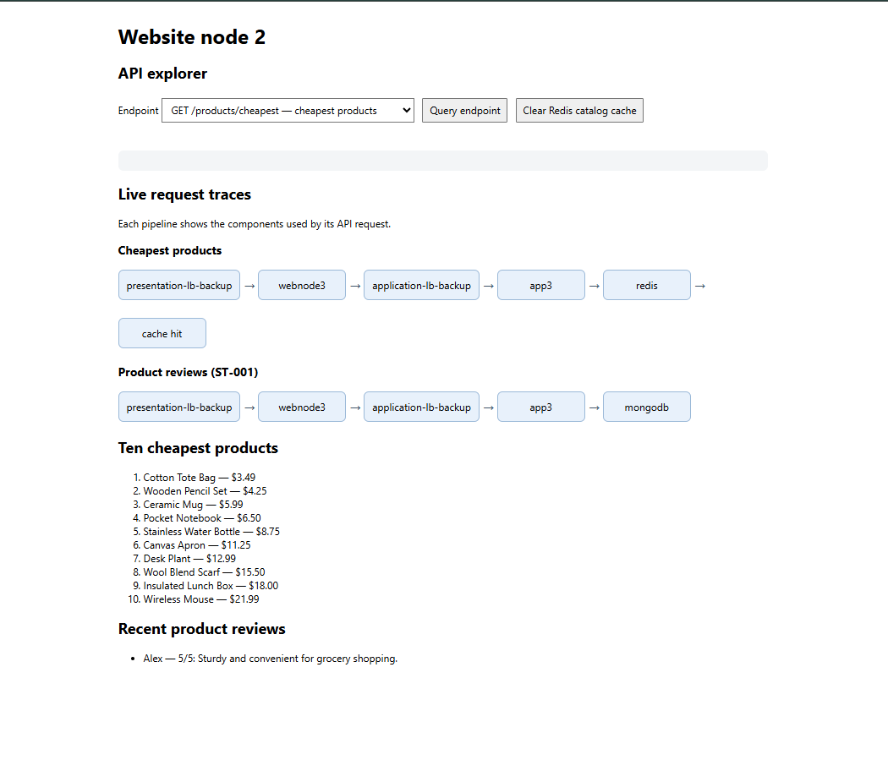
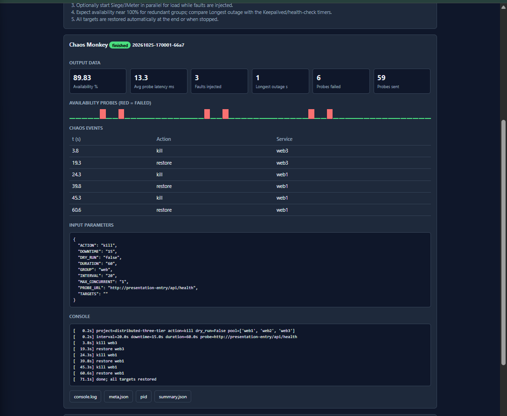
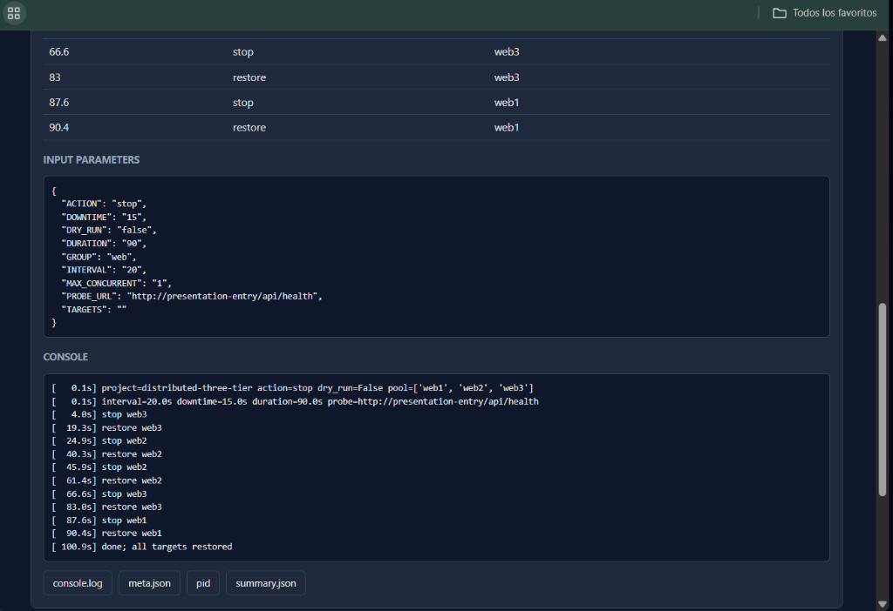
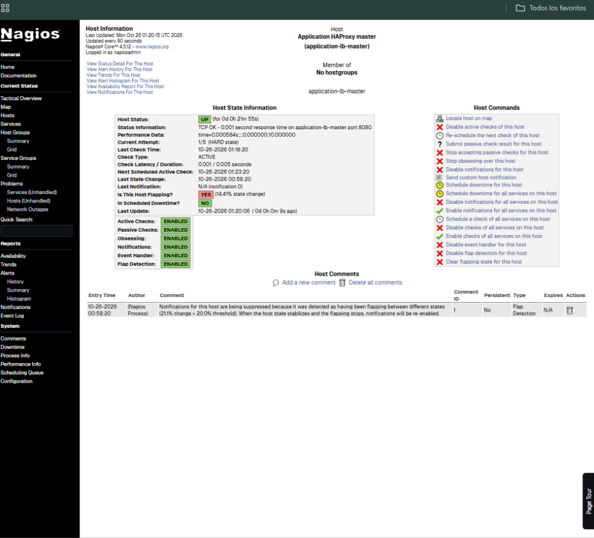

# Reporte de Práctica: Sistema Distribuido de 3 Capas de Alta Disponibilidad

* **Materia:** Sistemas Distribuidos
* **Tarea:** #995 - Arquitectura de 3 Capas Resiliente y Tolerante a Fallos
* **Alumno:** Jose Angel Mendez
* **Repositorio:** [github.com/JoseMendez07/sistemadistribuidode3capas](https://github.com/JoseMendez07/sistemadistribuidode3capas)

---

## 1. Introducción

En esta práctica construí y configuré un sistema distribuido completo basado en la arquitectura tradicional de tres capas (Presentación, Aplicación y Datos). El reto central del proyecto consistió en diseñar la infraestructura de tal forma que no existan puntos únicos de falla (*Single Point of Failure - SPOF*). 

Para lograrlo, combiné contenedores Docker orquestados con Docker Compose, balanceadores **HAProxy**, redundancia activa/pasiva con **Keepalived (VRRP)**, microservicios en **Node.js**, bases de datos políglotas (**Redis, MongoDB y MariaDB Galera Cluster**) y monitoreo en tiempo real mediante **Nagios Core**.

---

## 2. Objetivo del Proyecto

* **Alta Disponibilidad:** Garantizar que la plataforma siga operando aún ante la caída súbita de balanceadores, servidores web o nodos de base de datos.
* **Resiliencia:** Permitir que los componentes caídos se recuperen y se reintegren al clúster de manera automática y transparente para el usuario.
* **Escalabilidad y Balanceo:** Distribuir el tráfico de peticiones concurrentes de manera equilibrada entre múltiples réplicas en cada capa.
* **Validación Empírica:** Someter la infraestructura a pruebas reales de estrés (*ApacheBench*, *Siege*), pruebas de conmutación por error (*Failover*) e inyección intencional de fallos (*Chaos Monkey*).

---

## 3. Arquitectura del Sistema

A continuación se muestra el diagrama arquitectónico que diseñé para este proyecto:



### Flujo de Datos y Conectividad por Capa:

1. **Capa 1: Presentación (Subred `172.30.0.0/24`):**
   * El cliente entra mediante la IP Virtual (VIP) **`172.30.0.250`** en el puerto 80.
   * La VIP es administrada por un par Keepalived en modo VRRP: `presentation-lb-master` (prioridad 101) y `presentation-lb-backup` (prioridad 100).
   * El balanceador HAProxy activo reparte las solicitudes en Round-Robin entre 3 servidores web Nginx (`web1`, `web2`, `web3`), encargados de servir la interfaz de usuario estática.

2. **Capa 2: Aplicación y Microservicios (Subred `172.31.0.0/24`):**
   * El tráfico hacia `/api/*` se canaliza hacia la segunda IP Virtual (VIP) **`172.31.0.250`**.
   * Otro par de balanceadores HAProxy con Keepalived (`application-lb-master` y `application-lb-backup`) distribuyen las peticiones de lógica de negocio hacia 3 servidores de API en Node.js Express (`app1`, `app2`, `app3`).

3. **Capa 3: Datos y Persistencia:**
   * **Caché en Memoria (Redis 7):** Atiende las consultas de productos con respuesta casi instantánea. Tiene persistencia AOF habilitada para no perder datos en caso de reinicio.
   * **Base Documental (MongoDB 8):** Almacena las reseñas de productos mediante un Replica Set (`rs0`) con autenticación por clave (`keyfile`).
   * **Base Relacional (MariaDB Galera Cluster):** Clúster multi-maestro síncrono de 3 instancias (`galera1`, `galera2`, `galera3`). A diferencia del repositorio base, aquí implementé un balanceador TCP dedicado **`galera-lb`** (HAProxy en puerto 3306) que reparte las consultas SQL equitativamente.

4. **Monitoreo y Banco de Pruebas:**
   * **Nagios Core (8080):** Monitorea continuamente la salud de los 16 hosts del sistema.
   * **Resilience Lab (8090):** Entorno aislado para ejecutar suites de pruebas de rendimiento y caos.

---

## 4. Mejoras Implementadas (ToDo.md)

Siguiendo las instrucciones del archivo `ToDo.md` del repositorio, apliqué las siguientes soluciones técnicas:

| Punto | Componente | Reto | Solución Implementada |
| :---: | :--- | :--- | :--- |
| **2.1** | **MongoDB** | Replica Set y Autenticación | Se inicializó el Replica Set `rs0` mediante un script de entrada automatizado. Se generó un archivo `keyfile` con permisos estrictos `chmod 400` y propiedad del usuario del sistema `mongodb:999` para permitir autenticación interna segura entre nodos. |
| **2.2 & 2.3** | **Redis** | Pérdida de Caché al reiniciar | Se habilitó la persistencia **Append-Only File (AOF)** con la directiva `--appendonly yes --appendfsync everysec` montada sobre un volumen Docker persistente (`redis-data:/data`). |
| **3.0** | **Galera Cluster** | Punto único de fallo y quórum | Se creó el servicio **`galera-lb`** (HAProxy TCP en el puerto 3306) para que las aplicaciones no dependan de una IP estática de MariaDB. Además, se configuró `MARIADB_GALERA_FORCE_SAFETOBOOTSTRAP: "yes"` para permitir la autorecuperación del nodo bootstrap tras fallas abruptas. |

---

## 5. Pruebas de Concepto (PoC) y Resultados

### 5.1. Pruebas de Carga y Rendimiento (Load Testing)

#### A. ApacheBench (`ab`)
Se ejecutó una prueba de estrés de 1,000 peticiones concurrentes (concurrencia = 20) contra la página principal:



* **Peticiones completadas:** 1,000 req
* **Peticiones fallidas:** 0 (100% de éxito)
* **Throughput:** **1,469.64 peticiones por segundo (RPS)**
* **Latencia media:** **13.609 ms** (Percentil 95 en 29 ms, Percentil 99 en 36 ms)

#### B. Siege (Prueba de Carga Continua)
Para medir la estabilidad a lo largo del tiempo, se ejecutó una prueba sostenida durante 30 segundos con 20 usuarios recurrentes navegando entre múltiples endpoints (`/`, `/api/health`, `/api/products/cheapest`):



* **Transacciones totales:** 27,263 transacciones
* **Throughput:** **901.55 transacciones/segundo**
* **Disponibilidad:** **100.00 %** (0 fallas)
* **Tiempo de respuesta medio:** **0.02 segundos**

---

### 5.2. Pruebas de Conmutación por Error (Simple Failover)

#### A. Caída del Balanceador Maestro de Presentación
Se detuvo intencionalmente el contenedor `presentation-lb-master`. Nagios Core detectó inmediatamente el estado crítico del master, mientras que Keepalived transfirió la IP Virtual (`172.30.0.250`) a `presentation-lb-backup` en milisegundos:



#### B. Prueba de Caída Extrema (7 Contenedores Caídos a la vez)
Para poner al límite la arquitectura, simulé una catástrofe apagando simultáneamente **7 contenedores principales**:
* `presentation-lb-master` (Balanceador Web Master)
* `web1` y `web2` (2 de 3 servidores Nginx)
* `application-lb-master` (Balanceador API Master)
* `app1` y `app2` (2 de 3 microservicios Node.js)
* `galera3` (1 nodo del clúster de base de datos)



* **Resultado:** La tienda continuó respondiendo y entregando el catálogo completo y las reseñas sin ningún error HTTP 502/503.
* **Traza en vivo confirmada:**
  $$\text{presentation-lb-backup} \longrightarrow \text{webnode3} \longrightarrow \text{application-lb-backup} \longrightarrow \text{app3} \longrightarrow \text{redis / mongodb}$$
  Esto demostró que con tan solo **1 balanceador web, 1 servidor web, 1 balanceador API, 1 servidor API y el quórum de base de datos**, el sistema se mantiene operativo al 100%.

---

### 5.3. Chaos Engineering (Chaos Monkey)

Utilizando el módulo de Chaos Monkey del laboratorio de resiliencia, configuré un experimento de 60 a 90 segundos con inyecciones de falla aleatorias (deteniendo servidores web activos con intervalos de 20s y 15s de inactividad):



* **Disponibilidad bajo ataque:** **89.83 %**
* **Tiempo máximo de corte (*Longest outage*):** **1 segundo** (tiempo que le toma al health check de HAProxy detectar la caída y sacar al nodo del pool).
* **Fallas inyectadas:** 3 eventos de caída forzada sobre `web1` y `web3`.



* **Autorecuperación:** Al finalizar el ciclo de pruebas, el orquestador confirmó:
  `[ 100.9s] done; all targets restored`
  Todos los contenedores afectados fueron reactivados y reincorporados automáticamente al balanceador.

---

### 5.4. Observabilidad y Monitoreo (Nagios Core)

Durante las pruebas continuas de corte y recuperación, Nagios Core no solo detectó las caídas, sino que activó automáticamente su mecanismo de **Flap Detection** al identificar que los balanceadores cambiaban de estado intermitentemente:



Esto demostró que el sistema de monitoreo previene tormentas de alertas cuando un nodo oscila, manteniendo la trazabilidad histórica de eventos.

---

## 6. Instrucciones de Despliegue y Uso

1. **Clonar el repositorio:**
   ```bash
   git clone https://github.com/JoseMendez07/sistemadistribuidode3capas.git
   cd sistemadistribuidode3capas
   ```

2. **Iniciar toda la infraestructura distribuida:**
   ```bash
   docker compose up -d
   ```

3. **Acceso a los puntos de entrada:**
   * **Tienda Web (Catálogo y Reseñas):** `http://localhost:80` (o `http://localhost:8000`)
   * **Monitoreo Nagios Core:** `http://localhost:8080` *(Usuario: `nagiosadmin` / Contraseña: `nagios`)*
   * **Laboratorio de Resiliencia:** `http://localhost:8090`

---

## 7. Conclusiones

* **Desacoplamiento total:** Separar el balanceo web del balanceo de aplicaciones permite que la falla de un microservicio no tire la entrega de páginas estáticas ni bloquee al resto de servicios.
* **Transparencia mediante VRRP:** La implementación de Keepalived con IPs virtuales (`172.30.0.250` y `172.31.0.250`) logró que la conmutación entre el balanceador Master y Backup sea invisible para los usuarios finales.
* **Persistencia y Consistencia:** La configuración de persistencia AOF en Redis evitó pérdidas de caché en frío, y el balanceador `galera-lb` distribuyó equitativamente la carga SQL sobre el clúster síncrono.
* **Resiliencia comprobada:** El sistema demostró que soporta la caída simultánea de más del 40% de sus componentes sin degradación funcional.
